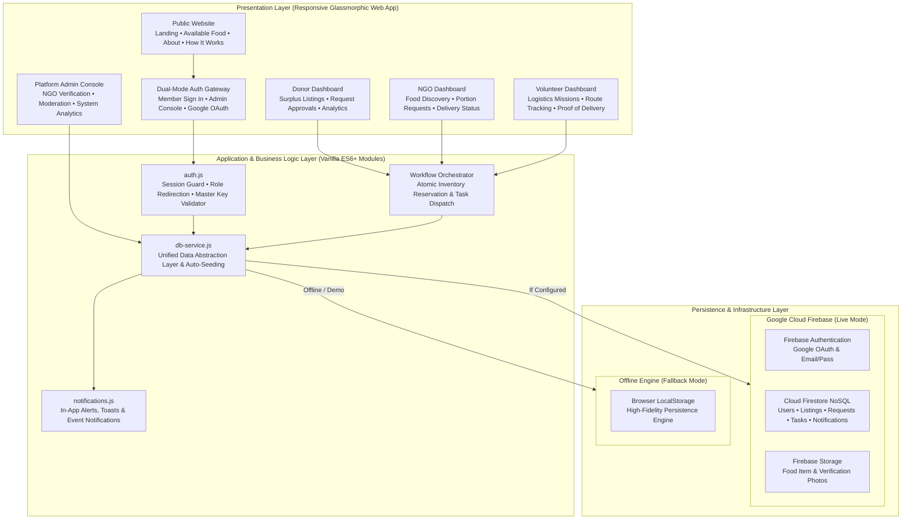
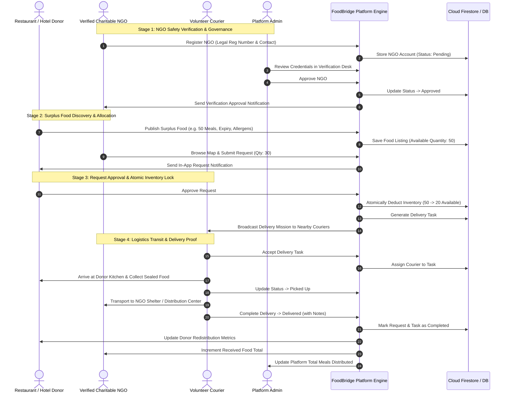
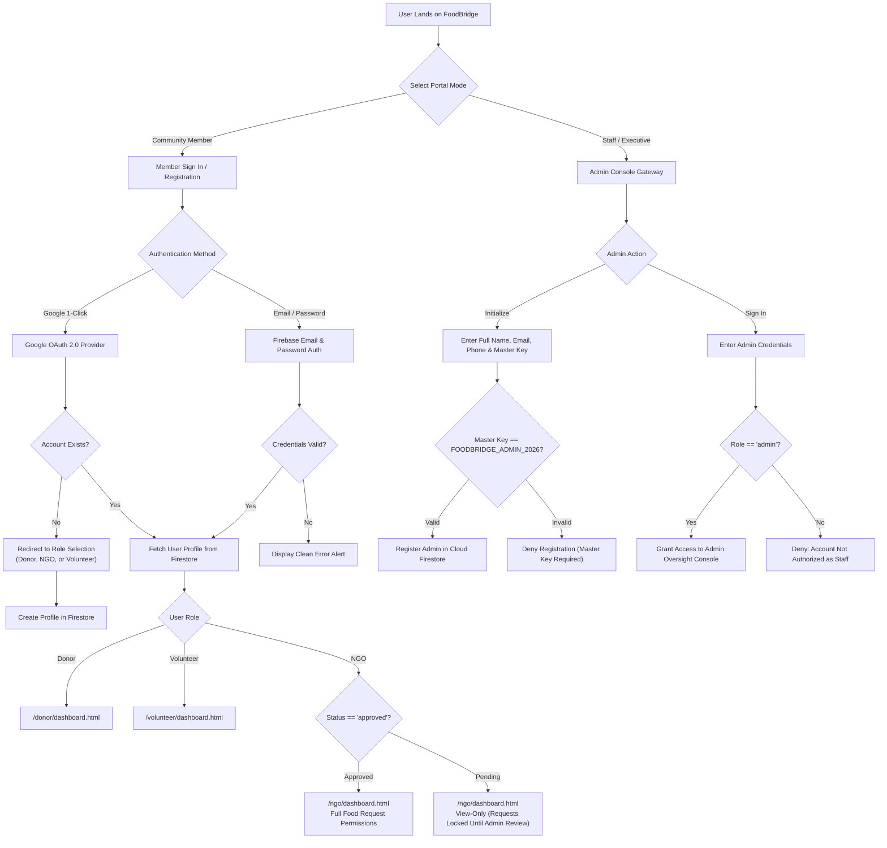
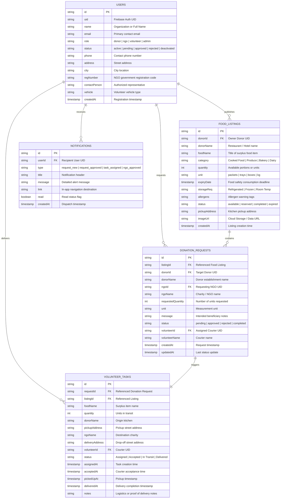

# 🌿 FoodBridge – Surplus Food Redistribution Platform

[](https://developer.mozilla.org/en-US/docs/Web/HTML)
[](https://developer.mozilla.org/en-US/docs/Web/CSS)
[](https://developer.mozilla.org/en-US/docs/Web/JavaScript)
[](https://firebase.google.com/)
[](https://www.chartjs.org/)
[](https://leafletjs.com/)

> *"Turning commercial food surplus into verified community meals through transparent, real-time logistics."*

**FoodBridge** is a full-featured, production-ready web application engineered to bridge the critical gap between commercial food surpluses and local communities experiencing food insecurity. It coordinates **Food Donors** (restaurants, hotels, caterers, bakeries), **Verified NGOs** (charities, community food banks), **Volunteer Couriers**, and **Platform Administrators** into a unified, glassmorphic, transparent redistribution pipeline.

---

## 📑 Table of Contents

1. [System Architecture Diagram](#-system-architecture-diagram)
2. [End-to-End Donation Lifecycle](#-end-to-end-donation-lifecycle)
3. [Role-Based Access Control & Security Flow](#-role-based-access-control--security-flow)
4. [Firestore Data Schema (ERD)](#-firestore-data-schema-erd)
5. [Role-by-Role Feature Matrix](#-role-by-role-feature-matrix)
6. [Design System & UI Specs](#-design-system--ui-specs)
7. [Firebase Backend Integration](#-firebase-backend-integration)
8. [Quick Start & Local Setup](#-quick-start--local-setup)
9. [Automated Verification & Tests](#-automated-verification--tests)
10. [Project Directory Structure](#-project-directory-structure)

---

## 🏛️ System Architecture Diagram



---

## 🔄 End-to-End Donation Lifecycle

The diagram below illustrates the complete 11-stage journey from food publishing to community delivery:



---

## 🛡️ Role-Based Access Control & Security Flow

FoodBridge implements strict role isolation ensuring users only access authorized capabilities:



---

## 🗄️ Firestore Data Schema (ERD)

The platform's underlying NoSQL Cloud Firestore schema is structured around normalized document collections with relational foreign keys:



---

## 🎯 Role-by-Role Feature Matrix

| Feature Module | 🍽️ Donor | 🏢 NGO | 🚴 Volunteer | 🛡️ Admin |
| :--- | :---: | :---: | :---: | :---: |
| **Add & Manage Surplus Listings** | ✅ | ❌ | ❌ | ✅ (Moderation) |
| **Atomic Inventory Auto-Deduction** | ✅ | ❌ | ❌ | ✅ |
| **Interactive Leaflet OpenStreetMap** | ❌ | ✅ | ✅ | ✅ |
| **Submit Donation Requests** | ❌ | ✅ (If Approved) | ❌ | ❌ |
| **Approve / Reject Requests** | ✅ | ❌ | ❌ | ✅ |
| **Accept Delivery Missions** | ❌ | ❌ | ✅ | ❌ |
| **Step-by-Step Delivery Advancer** | ❌ | ❌ | ✅ | ❌ |
| **NGO Legal Verification Desk** | ❌ | ❌ | ❌ | ✅ |
| **User Access Control & Deactivation** | ❌ | ❌ | ❌ | ✅ |
| **Chart.js Visual Analytics & Trends** | ✅ | ✅ | ✅ | ✅ |
| **Real-Time Notification Bell & Toasts**| ✅ | ✅ | ✅ | ✅ |

---

## 🎨 Design System & UI Specs

FoodBridge is designed with a modern **Organic Glassmorphism** aesthetic tailored for high-end enterprise sustainability applications:

* **Natural Botanical Color Palette**:
  * **Deep Botanical Forest** (`#11332B`): Primary structural identity, headers, buttons, executive emblems.
  * **Emerald Sage** (`#227150`): Brand accent, status indicators, badges, active navigation pills.
  * **Morning Dew Mint** (`#E8F5EE`): Soft interactive container backgrounds, active tab pills.
  * **Harvest Gold** (`#E7A034`): Warnings, ratings, verified keys, staff badges.
  * **Organic Warm Canvas** (`#F9F8F3`): Warm background canvas replacing stark sterile whites.
* **Glassmorphic Finish**:
  * Frosted glass cards: `background: rgba(255, 255, 255, 0.92); backdrop-filter: blur(16px);`
  * Soft drop shadows: `box-shadow: 0 20px 45px -10px rgba(17, 51, 43, 0.12);`
  * Border radius hierarchy: Cards (`28px`), Inputs & Buttons (`14px`), Pills (`9999px`).

---

## 🔥 Firebase Backend Integration

FoodBridge is architected with a **Dual-Engine Persistence Layer**:

1. **Live Production Mode (Google Cloud Firebase)**:
   * **Firebase Auth**: Supports Google OAuth 2.0 Sign-In and secure Email/Password authentication.
   * **Cloud Firestore**: Real-time NoSQL collections for `users`, `foodListings`, `donationRequests`, `volunteerTasks`, and `notifications`.
   * **Firebase Storage**: Cloud bucket storage for food imagery and verification documents.
   * **Auto-Seeding Engine**: When connecting to a fresh Firestore instance, baseline workflow data automatically populates without manual SQL or JSON imports.
2. **Offline Fallback Engine (LocalStorage)**:
   * If network connection drops or Firebase is unconfigured, the application seamlessly falls back to an in-browser storage engine, ensuring zero downtime and fully offline demonstrability.

---

## ⚡ Quick Start & Local Setup

### 1. Clone the Repository
```bash
git clone https://github.com/Mohit16-sinha/Foodbridge.git
cd Foodbridge
```

### 2. Run with Local HTTP Server
FoodBridge is built with vanilla ES6+ web standards and requires no build tools, transpilers, or package managers:

```bash
# Option A: Using Python (Installed by default on macOS/Linux/Windows)
python -m http.server 3000

# Option B: Using Node.js (npx)
npx serve -l 3000
```
Open **[http://localhost:3000](http://localhost:3000)** in your browser.

### 3. Administrator Setup
To access the Administrator Console:
* Navigate to **[http://localhost:3000/login.html](http://localhost:3000/login.html)** and click the **Admin Portal** tab, or open **[http://localhost:3000/admin-login.html](http://localhost:3000/admin-login.html)**.
* Switch to **Create Admin Account**.
* Enter your details and the master authorization key:
  ```
  Master Platform Authorization Key: FOODBRIDGE_ADMIN_2026
  ```

---

## 🧪 Automated Verification & Tests

FoodBridge includes automated integration test suites validating component logic and end-to-end workflows:

```bash
# 1. Run Sidebar & UI Layout Integrity Test
node tests/test_sidebar.js

# 2. Run 11-Stage Workflow Verification Suite
node tests/test_workflow.js
```

**Workflow Test Output:**
```
=== STARTING FOODBRIDGE WORKFLOW VERIFICATION ===
[PASS] Database initialized. Total users: 9, Active listings: 6
[PASS] Donor authentication successful: The Green Fork Bistro (donor)
[PASS] Listing created: ID fl_001, Qty: 50 meal packets
[PASS] NGO authentication successful: Hope Feeding Mission (Status: approved)
[PASS] Request created: ID req_101, Requested: 30 meal packets
[PASS] Security Rule Enforced: Unapproved NGO blocked from requesting food
[PASS] Donor approved request req_101. Status: approved
[PASS] Inventory Atomically Reserved: Available quantity is now 20 / 50
[PASS] Volunteer accepted task task_501. Status: Accepted
[PASS] Volunteer picked up food: Status is now "Picked Up"
[PASS] Volunteer delivered food: Status is now "Delivered"
[PASS] Donation Request status synchronized to: "completed"
[PASS] Admin logged in: Platform Administrator
[PASS] Admin verified NGO "Sunrise Relief Foundation". Status updated to: "approved"
[PASS] Newly approved NGO can now request food: Request ID req_102

========================================================
🎉 ALL FOODBRIDGE WORKFLOW INTEGRITY TESTS PASSED 100%!
========================================================
```

---

## 📁 Project Directory Structure

```
Foodbridge/
├── index.html                   # Glassmorphic public landing page
├── about.html                   # Mission, food hygiene & legal Good Samaritan standards
├── available-food.html          # Public surplus directory with category & urgency filters
├── how-it-works.html            # 4-stage visual redistribution lifecycle walkthrough
├── contact.html                 # Direct community support & emergency channels
├── login.html                   # Segmented dual-mode sign in (Member vs Admin)
├── register.html                # Multi-role registration (Donor, NGO, Volunteer)
├── admin-login.html             # Standalone executive administrator console gateway
│
├── donor/                       # Donor Workspace
│   ├── dashboard.html           # Live metrics, quick publish, pending requests
│   ├── add-food.html            # Surplus food publishing form with expiry countdown
│   ├── my-listings.html         # Active & completed surplus inventory table
│   ├── requests.html            # NGO request approval desk with anti-overselling
│   ├── history.html             # Historical food donation archives
│   └── profile.html             # Restaurant / commercial establishment profile
│
├── ngo/                         # NGO Workspace
│   ├── dashboard.html           # Allocation tracker, urgent meal alerts
│   ├── available-food.html      # Interactive Leaflet map & request modal
│   ├── my-requests.html         # Live request lifecycle & volunteer tracking
│   ├── received-donations.html  # Received food logs & receipt receipts
│   └── profile.html             # Charity registration details & audit records
│
├── volunteer/                   # Volunteer Courier Workspace
│   ├── dashboard.html           # Active delivery tasks & logistics statistics
│   ├── available-tasks.html     # Open pickup dispatch board with map directions
│   ├── my-tasks.html            # Active mission tracker (Accept -> Pickup -> Deliver)
│   ├── history.html             # Completed delivery archives & impact statistics
│   └── profile.html             # Courier credentials, vehicle info, availability
│
├── admin/                       # Administrator Oversight Workspace
│   ├── dashboard.html           # Platform oversight, NGO queue, impact charts
│   ├── users.html               # User directory, role switcher, deactivation controls
│   ├── ngos.html                # NGO verification desk with Approve/Reject actions
│   ├── food-listings.html       # Platform-wide food listing moderation & removal
│   ├── donations.html           # Real-time donation request workflow monitor
│   ├── volunteers.html          # Courier logistics registry & delivery verification
│   └── reports.html             # Chart.js analytics reports & monthly trends
│
├── css/
│   ├── main.css                 # CSS custom property design tokens & resets
│   ├── landing.css              # Glassmorphic landing sections & hero typography
│   ├── dashboard.css            # Sidebar layout, mobile drawer, stat cards
│   └── components.css           # Role tabs, badges, modals, alerts, rounded forms
│
├── js/
│   ├── firebase-config.js       # Firebase v10 Modular SDK configuration & status
│   ├── seed-data.js             # Realistic baseline data (Donors, NGOs, Couriers, Food)
│   ├── db-service.js            # Unified Database Abstraction Layer (Firestore + LocalStorage)
│   ├── auth.js                  # Authentication engine, Google OAuth, session guards
│   ├── notifications.js         # Interactive toast system & notification bell dropdown
│   ├── dashboard-common.js      # Sidebar responsive controller & profile binder
│   ├── donor.js                 # Donor business logic & listing management
│   ├── ngo.js                   # NGO discovery logic & portion requests
│   ├── volunteer.js             # Volunteer dispatch & delivery advancement
│   └── admin.js                 # Admin verification desk & Chart.js engine
│
├── tests/
│   ├── test_sidebar.js          # Sidebar responsiveness & single-toggle verifier
│   └── test_workflow.js         # 11-step end-to-end integration test runner
│
├── firebase.json                # Firebase hosting & project configuration
├── firestore.rules              # Cloud Firestore security rules
├── storage.rules                # Firebase Storage security rules
├── FIREBASE_SETUP_GUIDE.md      # Detailed Firebase cloud setup documentation
├── .gitignore                   # Version control ignore rules
└── README.md                    # Flagship project documentation & architecture guide
```

---

## 📜 License & Acknowledgments

This project is open-source under the **MIT License**. Built with dedication to zero food waste and community hunger relief.
